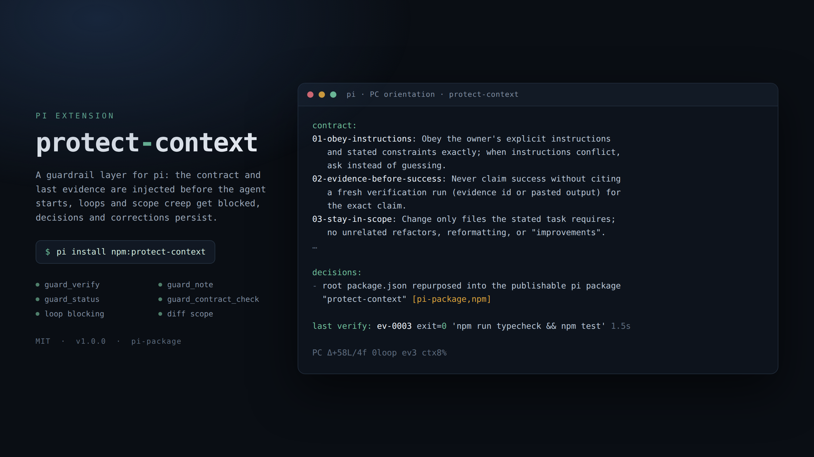

# protect-context · Agent Guardrail Suite

**Durable context, real evidence, and a brake pedal for AI coding agents.**

`protect-context` keeps the rules, decisions, and proof-of-work an agent needs in
front of it — then makes scope creep, unverified claims, and repeated failures
visible *before* they cost you a session.

<p align="center">
  <a href="./LICENSE"></a>
  <a href="https://pi.dev/packages"></a>
  <a href="pyproject.toml"></a>
  
  
</p>



One project-local `.agent-guard/` store · three interfaces backed by the same
logic:

| Interface | Use it for | Runtime |
|---|---|---|
| **pi extension** | Automatic brief injection, status widget, loop blocking, diff warnings, risky-command confirmation | TypeScript, loaded by pi via jiti |
| **MCP server** | Portable model/host access to the same tools | Python 3.10+, `fastmcp` |
| **Python CLI** | People, scripts, CI, and hosts without MCP | Python 3.10+ |

The suite is **advisory-first**. It records evidence and makes unsafe or
repetitive behavior visible; it is not a sandbox and does not prove that a
change is correct. [`SPEC.md`](./SPEC.md) is the frozen v1.0 contract.

## Contents

- [Why this exists](#why-this-exists)
- [What it does](#what-it-does)
- [Quick start](#quick-start)
  - [Install the pi extension](#install-the-pi-extension)
  - [Install the MCP server](#install-the-mcp-server)
  - [Install the Python CLI](#install-the-python-cli)
  - [From source](#from-source)
- [A 30-second tour](#a-30-second-tour)
- [Interface comparison](#interface-comparison)
- [Reference](#reference)
  - [pi commands and tools](#pi-commands-and-tools)
  - [MCP tools](#mcp-tools)
  - [CLI](#cli)
  - [Configuration](#configuration)
  - [Environment variables](#environment-variables)
  - [Runtime store and concurrency](#runtime-store-and-concurrency)
- [The 12 failure modes and what ships](#the-12-failure-modes-and-what-ships)
- [How it works](#how-it-works)
  - [Session lifecycle](#session-lifecycle)
  - [The brief](#the-brief)
  - [Evidence and loop detection](#evidence-and-loop-detection)
  - [Scope audit](#scope-audit)
  - [Trust and provenance](#trust-and-provenance)
  - [Context budget](#context-budget)
- [Development and validation](#development-and-validation)
- [Troubleshooting](#troubleshooting)
- [Limitations and security boundary](#limitations-and-security-boundary)
- [Design sources](#design-sources)
- [Non-goals](#non-goals)
- [License](#license)

## Why this exists

Long agent sessions fail in boring, expensive ways:

- the constraints you stated at minute two are gone by minute forty;
- "done" is claimed with no command output behind it;
- a "quick fix" quietly rewrites six unrelated files;
- decisions get re-litigated because nothing recorded the reasoning;
- the same failing command is retried until the context window dies.

`protect-context` treats those as **state** problems, not intelligence problems.
A durable store plus three small habits — brief before work, evidence after
work, journal when something is decided — removes most of the failure surface
without turning the agent into a different agent.

## What it does

| Primitive | What it gives you | Where you meet it |
|---|---|---|
| **Brief** | Contract, recent trusted decisions and corrections, open loops, and the last evidence ID, injected before the agent starts a turn | Automatic in pi; `orientation`, `status`, `guard_journal` elsewhere |
| **Orientation** | Bounded repo digest: tree, languages, and conventions files (`CLAUDE.md`, `AGENTS.md`, `CONVENTIONS.md`, `README.md`, `README`) | Injected once per digest in pi; `orientation` in CLI/MCP |
| **Evidence ledger** | Every verification run recorded as `ev-NNNN` with exit code, duration, command, and a bounded output digest | `guard_verify`, `protect-context verify`, `guard_evidence` |
| **Loop brake** | Identical failing commands are fingerprinted; the Nth attempt is blocked instead of re-run | Hard block in pi and the CLI; reported through MCP |
| **Scope audit** | `git` diff stats over tracked, staged, and bounded untracked work, with `ok` / `warn` / `hard` verdicts | Widget and `status` in pi; `diff`, `guard_diff_audit` |
| **Journal** | Durable `decision` / `correction` / `risk` / `note` entries with tags and trust levels | `guard_note`, `protect-context note`, `guard_journal` |
| **Risky-command confirm** | Nine catastrophic shell patterns get one grouped confirmation instead of none | pi, when a UI is available |
| **Preflight** | Tool presence and versions plus Git worktree detection | `preflight`, `guard_preflight` |
| **Context budget** | Watermarks on context usage and hard caps on every injected block | Widget, `budget`, `guard_budget` |

## Quick start

Python 3.10+ is required for the CLI and MCP server. Node 22.19+ is required
only to validate the TypeScript extension from a checkout — pi supplies the
extension's runtime modules, and the extension has **zero npm runtime
dependencies**.

### Install the pi extension

Installed from npm. The package declares `"pi": { "extensions":
["./extension/index.ts"], "image": "./preview.png" }` and the `pi-package`
keyword required by the Pi package gallery:

```sh
pi install npm:protect-context

# Try it for one run without adding it to settings
pi -e npm:protect-context
```

Or copy/symlink the checkout into a trusted extension directory:

```sh
# Personal
mkdir -p ~/.pi/agent/extensions
cp -r extension ~/.pi/agent/extensions/protect-context

# Project-local (read after the project is trusted)
mkdir -p .pi/extensions
cp -r extension .pi/extensions/protect-context
```

Start a session and you get a single-line status widget, a brief before the
first turn, and five slash commands. No configuration file is needed: the
extension seeds `.agent-guard/config.json` with the frozen defaults on first
session start.

### Install the MCP server

For pi with `pi-mcp-adapter`, add `.mcp.json` at the project root:

```json
{
  "mcpServers": {
    "protect-context": {
      "command": "/absolute/path/to/protect-context/.venv/bin/python",
      "args": ["-m", "protect_context.mcp_server"]
    }
  }
}
```

The same stdio shape works in any generic MCP host. Set `PC_SESSION_ID` when
several host sessions need distinct evidence and loop views:

```json
{
  "mcpServers": {
    "protect-context": {
      "command": "/absolute/path/to/protect-context/.venv/bin/python",
      "args": ["-m", "protect_context.mcp_server"],
      "env": { "PC_SESSION_ID": "my-session" }
    }
  }
}
```

The MCP surface exposes the nine frozen v1.0 tools plus two compatible read
surfaces added to close the original reachability gaps (`guard_journal` and
`guard_orientation`). Tools carry conservative MCP annotations; in particular
`guard_verify` is marked destructive and open-world because it can run any
shell command. Annotations are host hints, not enforcement — configure the host
to require human approval for that tool.

### Install the Python CLI

```sh
pip install protect-context      # or: pipx install protect-context
protect-context init             # seed .agent-guard/ in the current project
protect-context status
protect-context verify "pytest -q"
```

The CLI and MCP server are distributed through PyPI; the npm package ships only
the pi extension. Both read the same `.agent-guard/` directory, so a project can
use the extension in pi and scripted verification in CI at the same time.

### From source

```sh
# Python package, CLI, MCP server, and Python tests
python3 -m venv .venv
.venv/bin/python -m pip install -e ".[dev]"

# Reproducible extension development checks (dev dependencies only)
npm ci --ignore-scripts
npm run check
```

If the machine's default Node is older than 22.19, run the same checks with an
ephemeral Node 22 binary after `npm ci`:

```sh
npx -y node@22 node_modules/typescript/bin/tsc --noEmit -p extension/tsconfig.json
npx -y node@22 --experimental-strip-types --test extension/test/*.test.ts
```

## A 30-second tour

Excerpts from a real session in this repository.

Ask for the current state:

```console
$ protect-context status
PC status · session default · git 91fad4d
Δdiff +88/-8 · 6 files · verdict ok
loops: none
contract 12 constraints
conventions: README.md
Nudge: verify changes with guard_verify and cite the evidence id before claiming success.
```

Record proof instead of asserting it:

```console
$ protect-context verify "npm run check"
PC evidence ev-0005 · exit 0 · 1440ms
…output digest…
Nudge: cite evidence ids, not memory, when claiming success.
```

Re-run the same failing command a third time and the brake engages:

```console
$ protect-context verify "npm test"
PC verify blocked · npm test · 3 prior failures
Nudge: change approach or gather new information — do not re-run unchanged.
```

What pi injects before the agent starts working (sections elided):

```console
contract:
01-obey-instructions: Obey the owner's explicit instructions and stated constraints exactly; when instructions conflict, ask instead of guessing.
02-evidence-before-success: Never claim success without citing a fresh verification run (evidence id or pasted output) for the exact claim.
…
decisions:
- Use the atomic-mkdir lease, not fcntl alone; Python must interoperate with the extension. [locking,spec]
last verify: ev-0005 exit=0 'npm run check' 1.4s
```

And the always-on one-line widget:

```console
PC Δ+88L/6f 0loop ev5 ctx8%
```

## Interface comparison

| Capability | pi extension | MCP server | CLI |
|---|---|---|---|
| Brief injected automatically before a turn | yes (change-triggered) | — | — |
| Orientation digest (tree, languages, conventions) | injected once per digest | `guard_orientation` | `orientation` |
| Verification evidence (`ev-NNNN`) | `guard_verify`, `/guard-verify` | `guard_verify` | `verify` |
| Loop blocking | blocks the command | `guard_loop_check` reports and advises | `verify` refuses; `loops` exits 1 |
| Scope audit | session-start baseline + warnings | `guard_diff_audit` (explicit baseline) | `diff --baseline REF` |
| Journal write/read | `guard_note`, `/guard-note` | `guard_note`, `guard_journal` | `note`, `journal` |
| Trusted re-injection of decisions | yes, after change or compaction | read views only | read views only |
| Contract management | `/guard-contract` | `guard_contract` | `contract list\|add\|remove` |
| Risky-command confirmation | one grouped confirm | host approval policy | — |
| Status widget | yes | — | `status` |

## Reference

### pi commands and tools

Slash commands:

| Command | Action |
|---|---|
| `/guard-status` | Compact session status: diff verdict, loops, evidence, contract, context |
| `/guard-contract` | `list` · `add <text>` · `remove <id>` — edit the persistent contract |
| `/guard-verify` | Run a command through the evidence ledger |
| `/guard-note` | Journal a `decision` · `correction` · `risk` · `note` |
| `/guard-report` | Full session summary for handoff or review |

Model-callable tools:

| Tool | Arguments | Notes |
|---|---|---|
| `guard_verify` | `command`, `timeout_s` (default 180, clamped 1–900) | Records `ev-NNNN`; refusal on a blocked loop |
| `guard_note` | `type`, `text`, optional `tags` | Forced to the `agent` trust level |
| `guard_contract_check` | `summary` | Deterministic keyword coverage checklist, never a proof |
| `guard_status` | — | Same data that feeds the widget |

### MCP tools

| Tool | Annotation class | Purpose |
|---|---|---|
| `guard_status` | local, initializing read | Session status digest |
| `guard_verify` | **shell execution** (destructive, open-world) | Run a command, record evidence |
| `guard_evidence` | read-only | Recent verification entries |
| `guard_contract` | local mutation | `list` · `add` · `remove` |
| `guard_note` | local append | Journal an entry (tagged `agent`) |
| `guard_journal` | read-only | Recent journal entries, optionally filtered by type |
| `guard_loop_check` | local, initializing read | Failing-command streaks and advice |
| `guard_diff_audit` | local, initializing read | Diff stats and verdict vs thresholds |
| `guard_preflight` | local, initializing read | Tool/version and worktree check |
| `guard_budget` | read-only | Context-budget watermarks |
| `guard_orientation` | read-only | Repo digest and conventions files |

### CLI

Every command returns `0` for OK, `1` for a triggered warning or failed
verification, and `2` for an input/environment error.

```sh
protect-context init
protect-context status
protect-context verify "pytest -q" [--timeout 180]
protect-context evidence [--limit 5]
protect-context contract list
protect-context contract add "Keep the public API stable"
protect-context contract remove ID
protect-context note correction "use rg, not grep" --tags search
protect-context journal [--limit 5] [--type decision]
protect-context orientation
protect-context loops
protect-context diff [--baseline REF]
protect-context preflight
protect-context budget
```

### Configuration

The extension seeds `.agent-guard/config.json` on first session start; `init`
does the same for CLI/MCP-first use. Unknown, wrongly typed, fractional, or
out-of-range values fall back to the frozen default.

| Key | Default | Meaning |
|---|---:|---|
| `loop_block_after` | `3` | Block the Nth identical failing command attempt |
| `diff_warn_lines` | `400` | Changed-line warning threshold |
| `diff_hard_lines` | `800` | Changed-line hard-level threshold |
| `diff_warn_files` | `10` | Changed-file warning threshold |
| `ctx_warn_pct` | `70` | First context-usage warning watermark |
| `brief_mode` | `"changed"` | Inject only when the brief digest changes; `"always"` injects every turn |
| `risk_confirm` | `true` | Ask once before a matching risky pi bash command when UI is available |
| `preflight_tools` | `git`, `python3`, `pip`, `node`, `npm`, `rg`, `pytest` | Executables checked by preflight |

Numeric thresholds may be set to zero; the extension records an explicit first
notification so a zero watermark does not silently disable alerts. Preflight
checks at most 20 configured tool entries. If more are configured, it lists the
omitted count and returns a warning instead of claiming the environment is
fully checked. Version probes have a two-second per-tool timeout, share a
15-second overall deadline, and decode at most 4 KiB of output; a missing
version is reported as an incomplete preflight.

The nine catastrophic patterns that trigger the pi confirmation are frozen and
deliberately narrow, so benign lookalikes stay silent:

`rm -rf /` · `rm -rf ~` · `git push --force` (not `--force-with-lease`) ·
`git reset --hard` · `mkfs … /dev/…` · `dd … of=/dev/…` ·
`chmod -R 777 /` · `curl … | sh` · `sudo rm`

### Environment variables

| Variable | Effect |
|---|---|
| `PC_SESSION_ID` | Names the session used for evidence and loop views, so parallel hosts do not share a view |

### Runtime store and concurrency

Runtime files stay in the frozen `.agent-guard/` layout and are gitignored:

`config.json` · `contract.json` · `journal.jsonl` · `events.jsonl` ·
`verify_runs.jsonl` · `state.json`

Python and TypeScript use the same atomic-directory lease at
`.agent-guard/.lock.d`, with an owner token, PID/hostname checks, bounded
waiting, and conservative stale recovery. Python also takes its legacy local
`fcntl.flock` inside that lease. Evidence-ID allocation, JSONL appends, and
contract read-modify-write operations hold the shared lease, preventing
duplicate IDs and lost contract updates across runtimes. JSON file replacement
uses unique temporary files.

The lease follows the atomic `mkdir` design used by mature lock libraries while
remaining dependency-free and interoperable with Python. A crashed same-host
owner is reclaimable after the stale interval; a stale foreign-host owner fails
closed because process liveness cannot be proved safely without an external
coordinator. Recovery retains a small identity-bound `.lock.d.stale.*`
directory as a durable race guard; it does not block new writers and lives
inside the already-ignored runtime store. Contract mutations also fail closed
when owner rows are malformed, preserving the original file for repair.

## The 12 failure modes and what ships

| # | Failure mode | Shipped mitigation | Enforcement |
|---|---|---|---|
| 1 | Violating instructions | Persistent contract; provenance-aware, change-triggered brief injection; seed-removal refusal at the MCP boundary | Context/advisory |
| 2 | Claiming success without verification | Verification ledger, evidence IDs, status/evidence views, failure digests | Recorded evidence; not semantic proof |
| 3 | Editing too much / scope creep | Git diff audit over tracked, staged, and bounded non-ignored untracked work; safe explicit baselines | Warn/advisory |
| 4 | Misunderstanding the repo | Worktree-root-aware bounded orientation digest in pi, CLI, and MCP; conventions-file discovery | Automatic context + explicit read |
| 5 | Plausible but subtly wrong code | Deterministic contract checklist, verification gate, test-required seed | Heuristic/advisory |
| 6 | Losing earlier context | Persistent journal; recent trusted decisions re-injected after change and compaction; CLI/MCP read views | Automatic context + explicit read |
| 7 | Repeating corrected behavior | Bounded tagged corrections; trusted corrections re-injected; model-authored entries retained for owner review | Automatic context + trust boundary |
| 8 | Large diffs | Configurable line/file warning and hard-level notifications, status verdict, widget | Warn/advisory |
| 9 | Repetitive debugging loops | Shared bash/evidence streak reconstruction; third identical failing command blocked by default in pi, CLI, and MCP | Hard block at configured threshold |
| 10 | Environment/tool failures | Tool/version and Git-worktree preflight with warning exit outside a repository | Diagnostic |
| 11 | Permission interruptions | One grouped pi confirmation for the frozen risky-command patterns; environment preflight | Interactive confirmation where UI exists |
| 12 | Token/API cost and latency | Bounded brief sections, journal/contract text, evidence digests, untracked reads, output previews, and context watermarks | Automatic budgeting/advisory |

"Shipped" means the mitigation is reachable and tested. It does not turn an
advisory signal into a security or correctness guarantee.

## How it works

### Session lifecycle

The extension is a thin event layer over the shared store. Nothing leaves your
machine: there are no network calls and no LLM calls in the guardrail logic.

| Event | What happens |
|---|---|
| `session_start` | Seed config if missing, scan orientation, freeze the diff baseline, start the status widget |
| `before_agent_start` | Build the brief; inject orientation and/or brief as a hidden message when their digests changed |
| `tool_call` (bash) | Match the nine risky patterns → one grouped confirm; check the loop fingerprint → block at the threshold |
| `tool_execution_start` / `tool_execution_end` | Record bash outcomes and verify results into the shared loop state and evidence ledger |
| `turn_end` | Refresh the widget: diff stats, open loops, evidence count, context percentage |
| `session_compact` | Re-inject trusted context so compaction cannot silently erase it |
| `session_shutdown` | Flush state and clear the widget |

### The brief

The brief is deliberately tiny — a persistent prompt that grows without bound is
its own failure mode. Within the frozen 12-line constraint cap:

1. newest **owner** constraints are selected first,
2. then the frozen seed constraints,
3. then other entries.

An agent-authored constraint therefore cannot crowd out a seed. Below the
contract it carries up to 3 recent trusted decisions, up to 3 trusted
corrections, up to 2 open loops, and the last evidence ID with its exit code,
duration, and a truncated command. `brief_mode: "changed"` (default) injects
only when the rendered digest actually changed, so a quiet turn costs nothing.

### Evidence and loop detection

`guard_verify` runs your command with the caller's privileges, spools output to
temporary files to bound RAM, and records one append-only entry: ID, exit code,
duration, command, and a digest of the output. IDs are allocated inside the
shared lease, so parallel pi and CLI processes never collide.

Loop detection normalizes a command (whitespace collapsed, including inside
quoted strings) into a fingerprint, then counts consecutive failures of that
fingerprint across both bash and `guard_verify`. At `loop_block_after` the
attempt is refused, with the prior failure count and a change-strategy nudge —
the single cheapest intervention in the suite.

### Scope audit

Diffs are computed with `git` porcelain/numstat over tracked, staged, and
bounded non-ignored untracked files, then compared against the configured line
and file thresholds to produce `ok`, `warn`, or `hard`. The pi extension freezes
its baseline at session start, so committing mid-session does not reset the
scope; CLI and MCP default to `HEAD` and accept an explicit baseline.

Untracked content reads are capped at 1,000 files, 1 MB per file, and 8 MB
total, and stop once the hard line threshold is known. A truncated scan is
reported as a bounded scan, promoted to at least a warning (CLI exit `1`), and
its count treated as a lower bound — the widget renders it as `Δ≥`.

### Trust and provenance

Direct CLI and pi slash-command contract writes are treated as owner input.
MCP/model journal writes are forcibly tagged `agent`: they stay inspectable
through journal views but are not re-injected as trusted decisions or
corrections. CLI and pi slash-command journal entries are trusted. Untagged
legacy entries are treated as trusted for backward compatibility, because the
frozen journal schema has no dedicated author field.

This is a provenance convention, not authentication. A model that already has
shell access can invoke the CLI and appear on that trusted path; use host-level
tool permissions when the distinction must be a security boundary.

All newly stored contract, journal, and tag text is normalized to one bounded
line, and legacy values are normalized again when rendered. This prevents
terminal-line forging and unbounded persistent prompt growth; it does not make
untrusted prose safe to follow.

### Context budget

Every injected and printed block has a cap: brief sections, journal and contract
text, evidence digests, orientation output, and previews. Context-watermark
notifications fire at `ctx_warn_pct` and above, and the widget always shows the
current percentage. The result is a guardrail layer whose own cost stays
constant while a session grows.

## Development and validation

```sh
.venv/bin/pytest -q                          # Python suites
npm run typecheck                            # extension types (tsc --noEmit)
npm test                                     # extension unit tests (node --test)
.venv/bin/python -m compileall -q src        # byte-compile check
.venv/bin/python -m build --outdir /tmp/protect-context-dist
```

`npm run check` runs the typecheck and the extension tests together. The
definition-of-done checks are run twice consecutively before release. The dated
audit records the observed counts, integration probes, and package smoke test
instead of leaving stale numbers in this README.

| Path | Contents |
|---|---|
| `src/protect_context/` | Store, contract, journal, verify, loops, diff scope, orientation, preflight, budget, report, CLI, MCP server |
| `extension/` | pi entry point (`index.ts`) and pi-import-free `lib/` modules |
| `tests/` | pytest suites, including a fastmcp in-memory client smoke over every MCP tool |
| `extension/test/` | `node --test` suites for fingerprinting, risk patterns, loops, brief digest, widget, git parsing, config |
| `SPEC.md` | Frozen v1.0 contract — structure, defaults, and definition of done |

## Troubleshooting

| Symptom | Likely cause | Fix |
|---|---|---|
| No brief appears in pi | Digest unchanged (`brief_mode: "changed"`) and nothing new to say | Expected on quiet turns; set `brief_mode: "always"` to see it every turn |
| `Δ?` in the widget | Not a Git worktree, so no diff baseline | Run inside a repository, or use the CLI with an explicit `--baseline` |
| `Δ≥` in the widget | Bounded untracked scan hit a cap | Treat the count as a lower bound; narrow the scan or review scope manually |
| Loop never blocks | Commands differ (paths, flags) so fingerprints differ | Compare with `loops` / `guard_loop_check`; fingerprints intentionally ignore whitespace only |
| `PC_SESSION_ID` changes nothing in evidence | It scopes ledger *views*, not `state.json` | Expected: state is project-global by design |
| MCP tool missing in host | Server not started with the venv interpreter | Point `command` at `.venv/bin/python` and pass `-m protect_context.mcp_server` |
| Extension does not load | Node older than 22.19 or pi not restarted | Check `pi list`, then restart; use `pi -ne` to start without extensions |
| Contract edit rejected over MCP | Removing a frozen seed constraint | Seeds are protected; use the CLI or a pi slash command as the owner |

## Limitations and security boundary

#### Shell execution

- `guard_verify` deliberately invokes a shell with the caller's privileges. It
  can modify files, access the network, or disclose data. The pi layer asks for
  confirmation only when one of the frozen regex patterns matches; the MCP layer
  relies on host approval. Neither is a shell parser or a sandbox.
- MCP annotations are untrusted hints. A client may ignore them. Do not expose
  `guard_verify` to an untrusted model without a real host sandbox/approval
  policy.

#### Evidence

- An evidence record proves only that one command returned one exit code. It is
  not cryptographically bound to a commit/worktree, has no freshness policy, and
  does not prove the claimed behavior.

#### Scope

- The pi extension freezes its diff baseline at session start, so committing
  mid-session does not reset its scope. CLI/MCP audits default to current
  `HEAD`; pass them an explicit baseline for cross-commit scope. Binary files
  count as files but zero lines.
- Untracked-file content reads are capped at 1,000 files, 1 MB per file, and
  8 MB total, and stop once the hard line threshold is known. Output explicitly
  reports a bounded scan, promotes it to at least a warning/CLI exit 1, and
  treats the truncated count as a lower bound.

#### Determinism

- The frozen brief carries at most 12 constraints. Overflow is visible, and
  owner constraints are prioritized, but hidden constraints are not enforced by
  context injection.
- Frozen fingerprint normalization collapses whitespace everywhere, including
  inside quoted shell strings. Semantically different commands can therefore
  share a loop fingerprint.
- The deterministic contract checker is keyword coverage, not program analysis.
  Treat every `addressed` result as a review prompt, not proof.

#### Store

- `state.json` is project-global. Atomic replacement prevents torn JSON, but
  simultaneous sessions can still overwrite notification/session state; use
  `PC_SESSION_ID` to separate ledger views, not state files.
- Commands and the last 2,000 output characters are stored verbatim. There is
  no automatic secret detector or redactor; never put credentials in commands or
  verification output.
- JSONL ledgers have no automatic retention or rotation. Output views stay
  bounded, but long-lived stores grow on disk and full session reconstruction
  becomes progressively more expensive; archive runtime state deliberately.
- Python verification bounds RAM by spooling output to temporary files, but a
  very noisy command can consume temporary disk until it exits. On Windows,
  killing the direct process cannot guarantee that every descendant exits.

## Design sources

The implementation was checked against primary or professional sources:

- Git's stable porcelain/other-file interfaces for non-ignored untracked
  enumeration: [git-status](https://git-scm.com/docs/git-status) and
  [git-ls-files](https://git-scm.com/docs/git-ls-files).
- Pi's documented lifecycle, tool, context, and UI APIs:
  [Pi extension documentation](https://pi.dev/docs/latest/extensions).
- The mature `proper-lockfile` design, which uses atomic `mkdir` rather than
  `O_EXCL`: [moxystudio/node-proper-lockfile](https://github.com/moxystudio/node-proper-lockfile).
  The package itself was not added because the frozen extension requirement is
  zero runtime dependencies and the lock must interoperate with Python.
- Operational-safety evidence motivating explicit constraints, failure
  transparency, and safe-halt behavior: [What Breaks When LLMs Code?](https://arxiv.org/abs/2605.30777)
  (ASE 2026), plus evidence-conditioned execution results in
  [Preventing Premature Commitment in Coding Agents](https://arxiv.org/abs/2607.28815).
- MCP's own warning that annotations are risk vocabulary rather than
  enforcement: [Tool Annotations as Risk Vocabulary](https://blog.modelcontextprotocol.io/posts/2026-03-16-tool-annotations/).

## Non-goals

No network or LLM calls are made by the guardrail logic itself. It is not a
sandbox, policy engine, auto-fixer, secret manager, or replacement for pi/MCP
host permissions. It complements those controls with durable context, evidence,
telemetry, and narrowly scoped blocking.

## License

MIT — see [`LICENSE`](./LICENSE). Copyright (c) 2026 XJTLUmedia.
